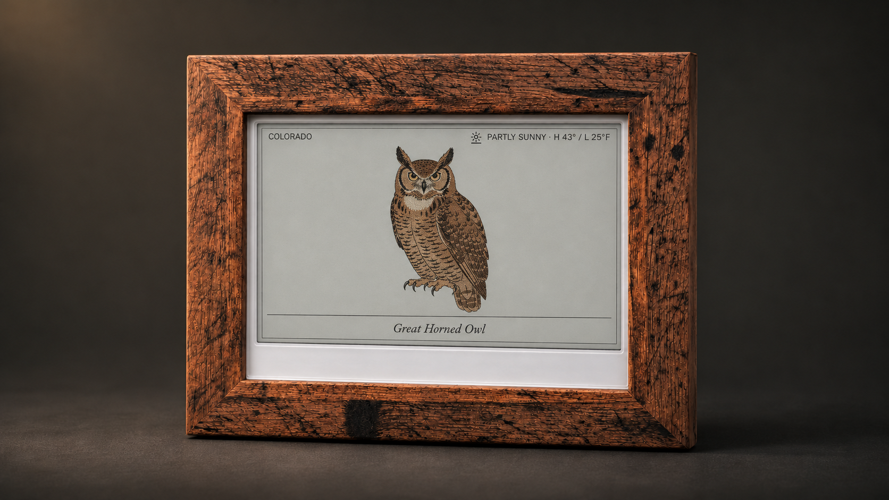

# Emviary

A nature-art gift built around the reTerminal E1002: Colorado birds, wildlife and
personal occasions, prepared by one small service and displayed on an e-paper
frame.



[Website](https://emviary.majjix.com/) · [User guide](https://emviary.majjix.com/guide) ·
[Owner management](https://emviary.majjix.com/manage) ·
[Frame gallery](docs/FRAME_GALLERY.md) ·
[Firmware](https://github.com/lstepnio/Emviary-firmware)

The product images are AI-assisted renderings based on the finished frame.
Original reference photographs remain private. Uploaded family pictures and personal
Special Days appear only on the frame and in signed-in management. The public and management frame
views use actual composition data beneath a transparent surround; promotional
pictures are not evidence of a physical panel refresh.

## Battery life is predicted to exceed a year between charges

[Read the observations and prediction method](docs/BATTERY_RESULTS.md).

The last picture stays visible even after the battery is empty. Changing it
requires power. While powered, the frame can rotate available cached pictures
without a network; new cloud artwork and fresh weather require a connection.

## How it works

One Python service renders reviewed art before the frame wakes. FastAPI serves
validated, immutable 800 × 480 Spectra 6 EPDGZ files; Pillow and the pinned
`epaper-image-convert` pipeline handle composition and conversion. SQLite stores
frame policies, preparation jobs, image history and device reports. Runtime uses
one application container, not a separate renderer or database container.

The backend owns artwork selection, one-to-three-bird layouts, wildlife slots,
weather, special days and schedules. The E1002 owns bounded downloads, checked
panel refresh, local cache/navigation, power management and persistent gift state.
Regional BirdWeather and optional eBird reports influence eligible species;
they do not establish that a bird visited the recipient's garden. Open-Meteo
and NWS supply dated forecast inputs. Missing or stale weather is omitted.
Normal operation needs no microphone, Raspberry Pi, AI API or paid subscription.

Artwork is reviewed offline. The catalog contains historical plates/cutouts,
original illustrated birds and wildlife, and private-reference pet portraits.
Eligibility, exclusions, provenance and per-asset licenses stay with the catalog.
Prepared previews and downloads remain distinct from device-reported display
success and owner-observed physical output.

## Everyday controls

| Control | Behavior |
| --- | --- |
| Left white, short press | Previous picture; preserves an armed gift welcome |
| Right white, short press | Next picture, or reveal the locally preloaded first gift artwork |
| Left white, hold five seconds | Local diagnostics |
| Green | Local/network wake and return from diagnostics to artwork |
| USB-C | Power and charging; normal interactive startup fetches once when online |

An armed gift welcome guards ordinary boot, timer and USB artwork replacement.
On battery, green does not mean next picture. E-paper refresh takes time; wait
for it to finish. Ordinary navigation coalesces pending taps, while gift
activation/reveal consumes taps that could accidentally skip the first picture.

Offline cache playback uses weather-neutral ordinary pictures. Special-day art
is excluded, and the server's exact neutral pixels remove stale forecast text.
Cached rotation uses the saved schedule while network probes back off. A small
battery icon appears at 25% or below and clears at 28% or on detected external
power, only during an ordinary artwork refresh.

## Owner management and gift preparation

Management covers appearance, special days, artwork/history, battery and device
health, schedules, saved Wi-Fi and guided USB recovery. Access uses the configured
owner password or owner OIDC identity. Explicit per-frame trusted-network opt-in
can recognize a recently authenticated frame's home network; browser traffic
alone cannot establish trust. See [network access](deployment/TRUSTED_NETWORK_ACCESS.md).
Public guide and showcase pages contain no private frame configuration.

Gift welcome is an explicit owner action, separate from the calendar and ordinary
image queue. Preview the dedication and first composition, then choose **Show
welcome on frame**. Both assets must be staged and verified locally before the
frame reports the welcome loaded. Check the actual screen, confirm it in management
and choose **Ready to wrap**. Wait for the frame’s acknowledgment, then switch it
off. The next power-on reveals the preloaded first artwork offline. Checked
refresh success commits opened state; the initial art holds for 30 minutes unless
manually browsed. Cancellation waits for online device acknowledgment before a
new package can replace it. Gift mode requires the v0.8.16 firmware with gift capability 2
implementation; published artifacts, installed versions and physical acceptance
are separate release gates. No gift is armed simply by deploying this source.

[RUNBOOK.md](RUNBOOK.md) is the current owner/operations guide.
[DEPLOYMENT.md](DEPLOYMENT.md) describes publication, rollout and recovery.
[PROJECT_STRUCTURE.md](PROJECT_STRUCTURE.md) identifies canonical paths.
[Research index](research/README.md) separates historical evidence from current use.

## Local development

```sh
git clone --recurse-submodules https://github.com/lstepnio/Emviary.git
cd Emviary
uv sync --locked
npm ci --ignore-scripts --prefix converter
npm run install --prefix converter/node_modules/canvas
uv run emviary add-frame local-e1002 --token-file .state/provisioning/local-e1002.token
uv run emviary prepare local-e1002 --offline
uv run emviary serve
```

The example config is `deployment/site.example.json`. Override paths with
`EMVIARY_CONFIG`, `EMVIARY_DATA_DIR`, `EMVIARY_ART_DIR` and `EMVIARY_BACKUP_DIR`.
For local owner bootstrap, set `EMVIARY_SECRET_DIR` to a private writable directory
and run `uv run emviary init-owner --password-file .state/provisioning/owner-login.txt`.
Device endpoints require the frame bearer token. Tokens, Wi-Fi passwords,
provider keys, provisioning exports and original family/pet photos stay private.
Never commit them or include them in public diagnostics.

```sh
uv run ruff check src tests tools
uv run ruff format --check src tests tools
uv run pytest -q
npm ci --prefix web-recovery
npm test --prefix web-recovery
npm run build --prefix web-recovery
```

Firmware is a separate Git submodule and release workflow. Do not incidentally
change its pin during service work. Recovery packages must use matching release
files and preserve NVS/LittleFS. Container publication follows successful source
checks and produces immutable commit tags/digests. Publication does not deploy
`one` or install firmware. Before rollout, capture the required verified backup
with `deployment/backup-before-home-rollout.sh`; change only Emviary.

## Artwork and attribution

Original service code is MIT licensed. Artwork retains its individual license,
including MIT, CC BY-SA, CC BY-NC-SA and public-domain sources; fonts retain OFL
licenses. Do not treat the service's license as a blanket artwork license.
See [catalog](art/catalog.json), [Fugleramme credits](art/FUGLERAMME-ATTRIBUTION.md),
[Colorado source credits](art/COLORADO-ATTRIBUTION.md),
[original bird provenance](art/provenance/ai-color-cutouts/README.md),
[wildlife provenance](art/wildlife/README.md) and
[occasion collection](art/occasions/README.md).

Emviary was previously named eInkArtifact. The service and firmware repositories
are public; private operational state remains outside tracked source. Historical
reports retain their original measurements and acceptance limits.
