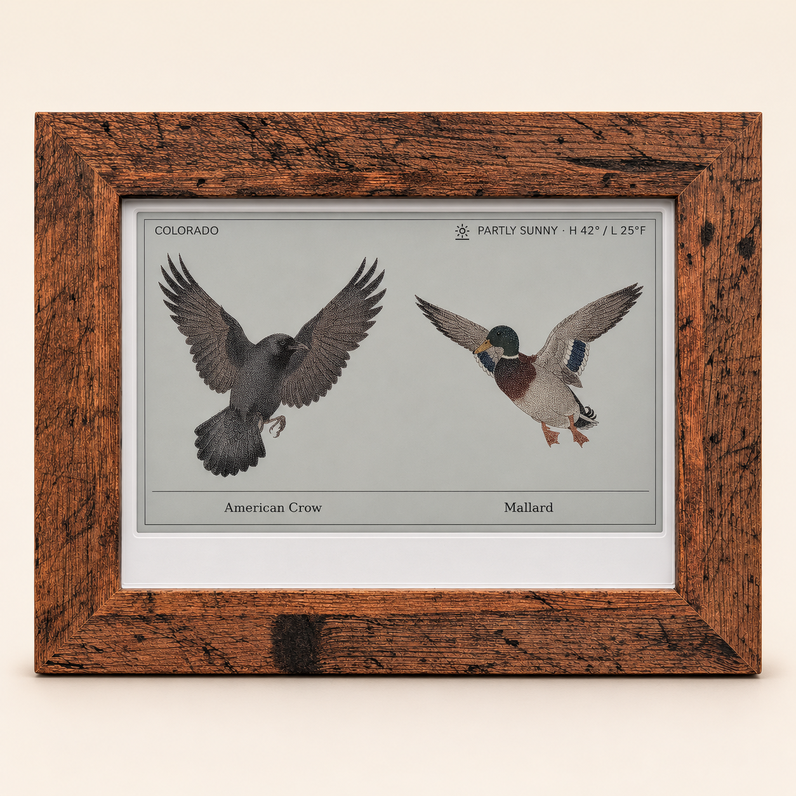
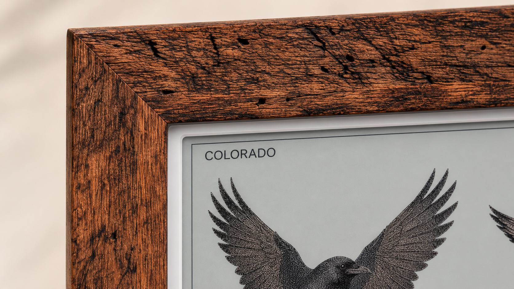
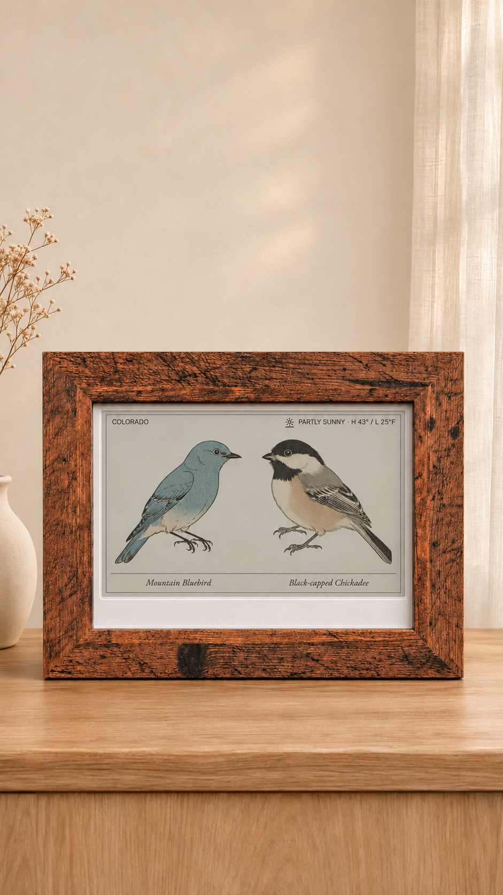
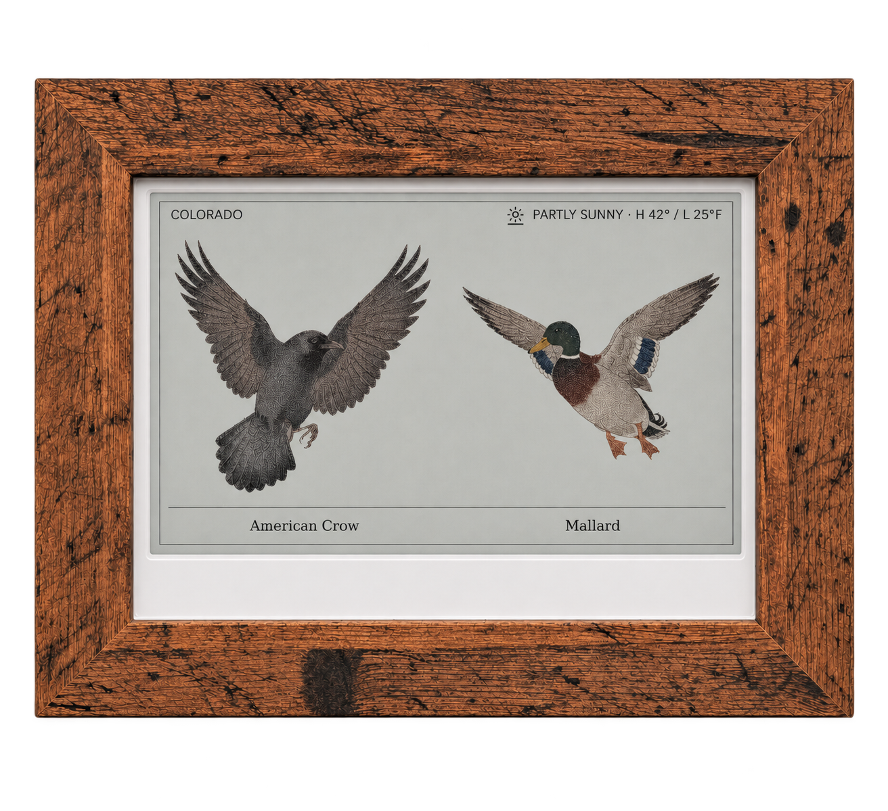
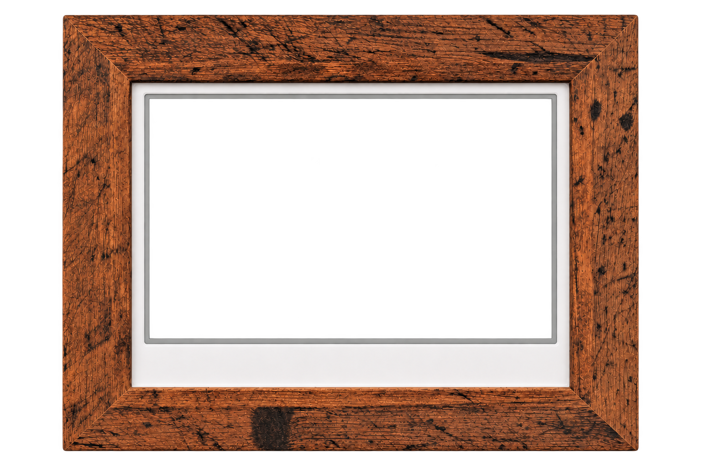
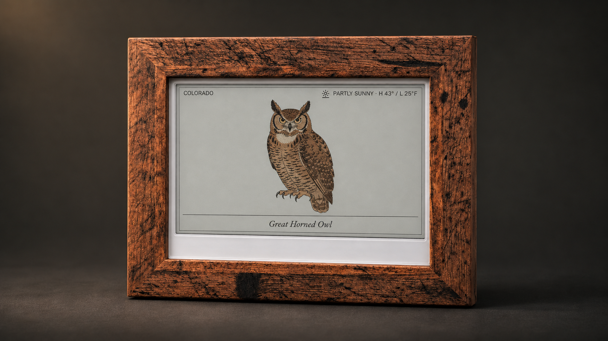
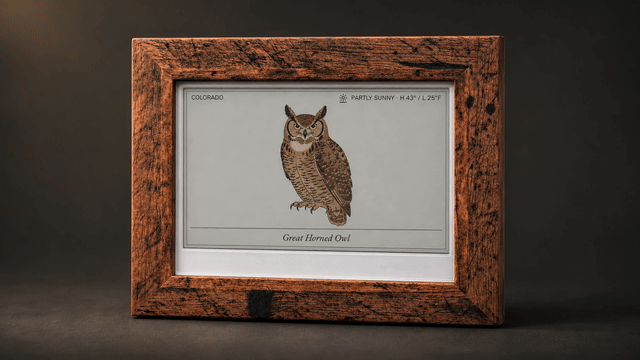
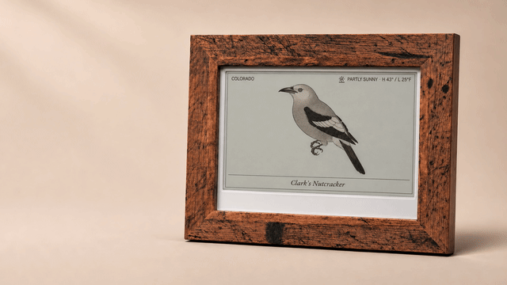

# The finished Emviary frame

A collection of eight AI-assisted product renderings, four films and two animations, based on photographs of the finished frame. Five different compositions show the artwork range: crow and mallard, Clark’s Nutcracker, a kingfisher/hawk/sparrow trio, Mountain Bluebird with Black-capped Chickadee, and Great Horned Owl. Matching details and clean interface assets retain the original composition where continuity helps.

[Explore the interactive showcase](https://emviary.majjix.com/showcase) · [See the last-delivered composition](https://emviary.majjix.com/)

## Early battery results

**The observed unplugged trend projects over a year to the 20% recharge threshold.** As of November 23, 2026, the frame reported 92% remaining after 41.1 days of unplugged observations, down six percentage points. This is an early projection with limited confidence, not a completed year-long endurance test. [Read the evidence and method](BATTERY_RESULTS.md).

## Photographs

### Studio portrait

### A different angle

### At home

### In the details

### A quiet corner

### Transparent product

### Transparent frame surround

### Dark studio

## Films

The films use gentle camera movement and dissolves over the AI-generated photographs. They are silent H.264 MP4 files at 30 fps. The e-paper artwork stays static.

| Film | Format | Duration |
| --- | --- | --- |
| [Product showcase](../src/emviary/showcase_assets/emviary-showcase-1080p.mp4) | 1920 × 1080 | 21 seconds |
| [Portrait film](../src/emviary/showcase_assets/emviary-portrait-1080p.mp4) | 1080 × 1920 | 10 seconds |
| [Dark studio loop](../src/emviary/showcase_assets/emviary-dark-loop-1080p.mp4) | 1920 × 1080 | 8 seconds |
| [Warm studio loop](../src/emviary/showcase_assets/emviary-studio-loop-1080p.mp4) | 1920 × 1080 | 8 seconds |

The [website gallery](https://emviary.majjix.com/showcase#films) has embedded players with playback and seeking controls. GitHub links above open the individual video files.

## Animations

These loops animate the camera framing, not the physical display. Expand either preview to view the GIF.

Dark studio animated preview

[Download dark studio GIF](../src/emviary/showcase_assets/emviary-dark-loop.gif)

Warm studio animated preview

[Download warm studio GIF](../src/emviary/showcase_assets/emviary-studio-loop.gif)

## How the current preview works

The management and public frame views place the actual delivered composition beneath the transparent wood-and-bezel surround. The promotional bird picture is not substituted for live composition data. The artwork endpoint and its existing authentication remain unchanged.

Media on the showcase page starts still. Videos have native controls; GIF previews have play and pause buttons. Images include alternative text, downloads remain available without JavaScript, and reduced-motion preference changes stop active GIF previews.

## Provenance

Created November 23, 2026 with the built-in image-generation tool, using seven supplied photographs as reference. Scenes, cleaning and lighting are AI-assisted. These are promotional renderings, not measurements or proof of physical display behavior. The transparent assets use actual alpha channels. WebP copies preserve the generated PNG pixels losslessly.

[Generation prompts](frame-rendering-prompts.json) record the initial directions, composition edits and first overlay iteration. [Composition references](frame-compositions.json) identify the catalog artwork used for the four replacement displays. These compositions were made by the application renderer before AI insertion into the product photos. The first overlay iteration was rejected; the refined surround is the published asset. Original source photos, PNG masters, render recipes and intermediate files remain in the local campaign package and are not published here.
