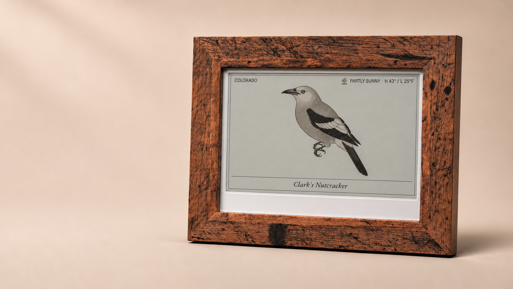
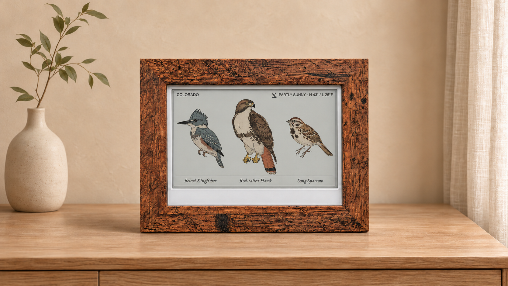

# The finished Emviary frame

A collection of eight AI-assisted product renderings, four films and two animations, based on photographs of the finished frame. Five different compositions show the artwork range: crow and mallard, Clark’s Nutcracker, a kingfisher/hawk/sparrow trio, Mountain Bluebird with Black-capped Chickadee, and Great Horned Owl. Matching details and clean interface assets retain the original composition where continuity helps.

[Explore the interactive showcase](https://emviary.majjix.com/showcase) · [See the last-delivered composition](https://emviary.majjix.com/)

## Early battery results

Battery life is predicted to exceed a year between charges. The last picture stays visible when the battery runs out. If Wi-Fi drops, the frame keeps cycling through saved pictures while it has power. [See the measurements](BATTERY_RESULTS.md).

## Photographs

### Studio portrait

### A different angle

### At home

### Frame detail

### Portrait view

### Transparent product

### Transparent frame surround

### Dark studio

## Films

The films use gentle camera movement and dissolves over the AI-generated photographs. They are silent H.264 MP4 files at 30 fps. The e-paper artwork stays static.

| Film | Format | Duration |
| --- | --- | --- |
| [Product showcase](../src/emviary/showcase_assets/emviary-showcase-1080p.mp4) | 1920 × 1080 | 21 seconds |
| [Portrait film](../src/emviary/showcase_assets/emviary-portrait-1080p.mp4) | 1080 × 1920 | 10 seconds |
| [Dark studio loop](../src/emviary/showcase_assets/emviary-dark-loop-1080p.mp4) | 1920 × 1080 | 8 seconds |
| [Warm studio loop](../src/emviary/showcase_assets/emviary-studio-loop-1080p.mp4) | 1920 × 1080 | 8 seconds |

The films remain available as downloadable production assets here. The website uses lightweight motion on the hero photograph instead of video players.

## Animations

These loops animate the camera framing, not the physical display. Expand either preview to view the GIF.

Dark studio animated preview

[Download dark studio GIF](../src/emviary/showcase_assets/emviary-dark-loop.gif)

Warm studio animated preview

[Download warm studio GIF](../src/emviary/showcase_assets/emviary-studio-loop.gif)

## How the current preview works

The management and public frame views place the actual delivered composition beneath the transparent wood-and-bezel surround. The promotional bird picture is not substituted for live composition data. The artwork endpoint and its existing authentication remain unchanged.

The showcase hero automatically drifts through a subtle 1.8% zoom in an 18-second alternating loop. It uses CSS and the existing photograph, with no extra media download or player. Reduced-motion preferences disable the effect. The management current preview stays still. The public showcase omits photo captions, download controls and promotional closing copy. Transparent production assets remain in this GitHub gallery.

## Provenance

Created November 23, 2026 with the built-in image-generation tool, using seven supplied photographs as reference. Scenes, cleaning and lighting are AI-assisted. These are promotional renderings, not measurements or proof of physical display behavior. The transparent assets use actual alpha channels. WebP copies preserve the generated PNG pixels losslessly.

[Generation prompts](frame-rendering-prompts.json) record the initial directions, composition edits and first overlay iteration. [Composition references](frame-compositions.json) identify the catalog artwork used for the four replacement displays. These compositions were made by the application renderer before AI insertion into the product photos. The first overlay iteration was rejected; the refined surround is the published asset. Original source photos, PNG masters, render recipes and intermediate files remain in the local campaign package and are not published here.
