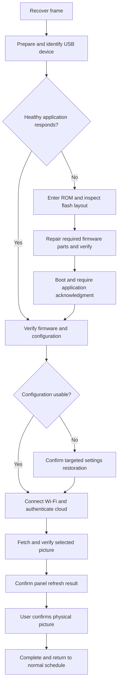

# Emviary USB recovery reliability plan

October 12, 2026. Design proposal, not an implementation or hardware qualification report.

## Decision

Use the existing, pinned esptool-js flasher inside a single recovery state machine. Add a small, explicitly activated USB status protocol to the application and a session-correlated cloud acknowledgment. Recovery must establish what happened at each layer before advancing or escalating. Preserve configuration and verified firmware writes; retry only the failed operation.

The goal is a predictable, consumer-friendly flow for the known failure matrix below. “Foolproof” cannot mean guaranteed success with a broken cable, damaged panel, unsupported host, or inaccessible ROM bootloader. It can mean no unexplained waits, no false success, no automatic destructive escalation, and one clear action when software cannot proceed.

Keep the current browser/service architecture. Do not add a permanent desktop helper, a second recovery firmware partition, an AI troubleshooting dependency, or routine debug logging. Temporary recovery diagnostics and bounded diagnostic flash writes are authorized; ordinary operation remains quiet.

## 1. Current evidence and actual gaps

Observed on this E1002:

- Browser recovery restored both deliberately invalid application slots through the ota_0 repair path. v0.8.3 retained two Wi-Fi profiles, fetched artwork, and passed the owner's physical RIGHT-button check.
- The v0.8.4 application header subsequently matched the published binary, and authenticated cloud fetches reported v0.8.4. This does not qualify every post-flash reset or physical panel/button behavior.
- One 460800 diagnostic read failed; subsequent 230400 and 460800 read probes passed. Compatibility is variable, so the adaptive transfer ladder remains necessary.
- The missing `data-usb-speed` element threw after completed writes. The UI incorrectly presented a serial/cable failure.
- Equal weighting of firmware files exaggerated progress. Separate wait phases restarted the countdown and concealed retries.
- “Check connection again” only polled the cloud. It did not wake an asleep frame over USB. Its fallback freshness cutoff could age out a valid earlier contact without initiating a new one.
- Quiet firmware gives the browser no structured application boot, Wi-Fi, or display acknowledgment. A successful reset command is not proof of application startup.
- Existing metrics arrive with artwork requests. No request gives inadequate evidence to distinguish sleep, boot, Wi-Fi, credentials, cloud service, and display failures.
- The current full-reset path can replace a binding before the new device configuration is proven usable. It needs staged activation, not an assumption that the USB write will succeed.
- Interrupted writes, corrupted bootloader/partition table, full reprovisioning, wrong settings, browser restart, and cross-platform automatic restart are not physically qualified.

Live service at planning time: 0.14.4, `emviary:poc-048`. Commit 470e665 builds 0.14.5 with a USB wake/check change and 17 passing recovery unit tests. It is staged, not deployed or physically accepted. The 0.14.4 CI suite passed. Leave the staged change out of production until acceptance.

## 2. The end-user flow

One primary action: **Recover frame**. Do not expose baud rates, addresses, boot modes, or repair strategy.

1. “Connect the frame with a USB data cable and turn its power switch on.”
2. Choose **Recover frame**. Reuse a previously authorized adapter only when the target is unambiguous. On first use, the browser requires selection of **USB Serial**, then **Connect**. Tell the user this before opening the picker.
3. Automatically inspect, recover only what is necessary, boot, restore supported settings if needed, connect, and display the picture.
4. “Does this picture appear on the frame?” **Yes, finish** or **No, help me**. This is the physical observation software cannot establish.

Do not offer another primary “Run recovery again” button while recovery is active or its connection has already passed. Resume the failed stage instead. An already healthy device should be verified without reinstallation.

User prompts are limited to:

| Situation | Exact type of action |
| --- | --- |
| First USB permission or several plausible adapters | Select USB Serial and Connect; browser permission cannot be bypassed. |
| No adapter appears | Reconnect a data cable, then retry; show official driver help only if evidence indicates a missing driver. |
| Port occupied | Close the named competing recovery tab when known, or other serial apps; do not pretend we can forcibly close another application. |
| Automatic ROM entry fails | Show the E1002-specific boot/reset sequence with a diagram, tested on this hardware revision. Do not guess its buttons from another ESP32 board. |
| Required Wi-Fi password missing from cloud | Ask once for that network/password. Retain it in cloud policy through the authenticated existing configuration flow. |
| Local settings must be replaced | One clear confirmation explaining exactly what changes. Cloud artwork, special days, schedule and display preferences remain intact. |
| Cable disappears mid-operation | “Reconnect the same frame. Recovery will continue automatically.” Ask to select a port again only if browser permission requires it. |
| Software verification passed | Confirm the physical picture once. |
| Unsupported or physically damaged device | Give a specific stopping reason and one support action. |

No repeated checkbox plus confirmation dialog for the same reset decision. One confirmation records the allowed reset scope for this recovery session; it is not permission to erase unrelated regions or another device.

## 3. One controller and explicit evidence

Separate `recovery-controller.mjs`, `recovery-transport.mjs`, and `recovery-ui.mjs`. Retain the pinned flasher and existing immutable bundle verification. The controller owns transitions, retries, deadlines, session identity and cancellation. The view only renders controller events. DOM decoration cannot cause a completed flash to become a failed flash.

Each controller event contains `session_id`, `attempt_id`, `device_identity`, `state`, `operation`, `elapsed_ms`, `evidence`, and a classified error. Never include Wi-Fi passwords, device tokens, raw NVS, or unfiltered serial logs.

| State | Positive evidence needed to advance |
| --- | --- |
| Preparing | Complete same-origin recovery bundle; SHA-256 and ranges verified; selected frame's cloud policy ready. |
| USB identified | Port opened, expected hardware identity matched when known; chip, memory and security checked before any write. USB bridge identifiers alone do not establish an E1002. |
| ROM synchronized | Known ROM sync at 115200, validated stub and readable flash geometry. |
| Firmware repaired | Full-region verification of each required part; correct table and boot selection. App header matching alone is insufficient. |
| Application booted | Structured response to this session's challenge, expected app version/build, actual boot identifier. A reset call returning is insufficient. |
| Configuration ready | NVS usable, selected frame binding present, valid network profiles, configuration revision confirmed. Do not disclose passwords. |
| Network ready | Device reports association and IP address, or a more advanced authenticated cloud acknowledgment proves this. |
| Cloud ready | Current-session nonce received from the expected bound device and expected firmware; successful authenticated image/config request. |
| Picture received | Device reports expected composition ID/digest and verified complete image body. Receiving a server request alone is insufficient. |
| Panel refreshed | Driver reports successful completion and BUSY release. This establishes driver success, not the absence of a physical panel defect. |
| Finished | Owner confirms the physical picture, or acknowledges a clearly labeled partial/offline outcome. |

Never label firmware unverified just because the cloud is unavailable. Never label the entire frame recovered just because a file write passed.

## 4. Minimal USB recovery protocol

Add a versioned, bounded request/response protocol on the existing USB UART, separate from debug logging. Confirm the E1002 UART and bridge mapping during implementation.

Proposed commands:

- `HELLO`: protocol version, board/build identity, boot ID, reset cause, initialization state and capabilities.
- `BEGIN_RECOVERY`: session nonce and temporary awake lease; enable recovery status responses and one explicit image request.
- `STATUS`: structured configuration, Wi-Fi, cloud, image and panel state with compact error codes.
- `END_RECOVERY`: stop the temporary session and resume the normal saved schedule.

If the normal picture pipeline cannot be validated, allow one small, known display test pattern generated by the recovery firmware. This separates image-content problems from panel/driver failure. Restore the current picture when available; do not clear the panel repeatedly. The final physical confirmation is still required.

Use framed messages with length bounds, sequence IDs and CRC. A session handshake keeps ROM text and incomplete bytes from being mistaken for a response. Commands must be idempotent. Bounded payloads, reader buffers and queue depth prevent a noisy serial connection from allocating unlimited memory.

The minimal recovery responder must become available before risky storage/display/network initialization can indefinitely block the normal application. Initialization must report its last completed stage and a bounded failure. The recovery protocol cannot depend on mounting a healthy image cache or joining Wi-Fi first.

Activate richer status only through an explicit browser command during USB/interactive startup. Do not add a listener to scheduled battery wakes. If the USB-power detector is unreliable, the interactive receive path must still accept a physical UART challenge; verify this before choosing the gate. Normal operation keeps debug logging disabled. Recovery may enable verbose, redacted USB diagnostics and bounded persistent checkpoints when needed. Use the explicit recovery mode and cleanup rules below; do not turn recovery tracing into routine logging.

A temporary RAM-only recovery lease suppresses deep sleep and automatic OTA while the session is active. Proposed lease: renew every 15 seconds, expire after 90 seconds without renewal, with a 10-minute absolute bound. Firmware must resume its normal schedule after browser closure or USB removal. These are initial engineering budgets, not measured device timings.

The boot ID and correlation nonce normally live in RAM; a bounded recovery checkpoint may preserve non-secret session identity across a reset. Resets lose the lease/nonce, so the browser re-establishes them after a new `HELLO`. Firmware never rolls back merely because Wi-Fi/cloud is down; preserve the existing offline boot-health distinction.

Older firmware has no responder. Treat ROM output only as evidence of ROM behavior, then use the verified installer to upgrade once. Do not scrape free-form debug logs as the permanent recovery protocol.

## 5. Recovery-only diagnostics and persistence

The owner explicitly permits debugging and flash writes during recovery. Use this permission to improve diagnosis, rather than restricting recovery to what is available during normal low-power operation.

- Enter an explicit recovery mode through the authenticated browser session and physical USB protocol. The application can temporarily enable verbose subsystem diagnostics, error/backtrace capture, driver timing and storage checks. Keep credentials and raw NVS values out of logs.
- Buffer the detailed trace in browser/RAM first. When reset/crash survival is useful, persist small structured checkpoints and a bounded diagnostic ring in the existing healthy filesystem. Proposed ceiling: 64 KiB of diagnostic storage, at most 16 checkpoint commits per session, and no continuous flash writes for every serial line. These are initial limits to validate, not required final constants.
- Do not assume the filesystem is healthy. If its diagnostic write fails, retain USB/RAM diagnosis and report storage failure. Do not create a new partition or overwrite arbitrary flash regions just to save logs. The recovery responder must remain useful without persistent storage.
- A short-lived recovery marker may survive resets, allowing the next boot to report the failing stage and temporarily remain in recovery. Bound it with an absolute recovery duration when time is valid and a persisted maximum recovery-boot budget when time is unavailable. Prototype five boots and ten active minutes. Exhaustion returns to quiet normal behavior or a explicitly labeled failure state, never endless verbose rebooting.
- Clear or disable the active recovery marker on successful completion, explicit cancellation and lease expiration. USB removal stops active tracing. Subsequent scheduled battery wakes do not renew a recovery lease, emit debug logs or append diagnostic records. Interrupted power-loss cleanup must have a tested boot path.
- Expose a concise owner-only recovery report after failure: last successful stage, failing operation/error code, attempts, timing, build and artifact hashes. Offer technical traces under optional details, not as the default interface. Retention on the server is bounded and redacted; frame traces are cleared after completion or the retention limit.
- Diagnostic writes are intentional recovery operations, not backups. Do not make a full flash dump or copy saved credentials. Existing ordinary cloud backup policy remains unchanged.

Acceptance must prove that recovery tracing helps identify a reset/initialization failure and that normal mode returns to its quiet behavior after success, browser closure, cable removal, crash, timeout and power loss. Merely setting a UI toggle off is insufficient.

## 6. Retry policy: recover the failed stage

Use one overall deadline with explicit per-operation deadlines. User-action time is paused and shown as “Waiting for you,” not counted as an active failure. All asynchronous work has cancellation and a deadline, including `open`, loader sync, reads, writes, hash verification, reset, boot response and cloud requests. No unbounded promise or retry loop. One shared attempt ledger prevents nested retry loops from multiplying the budget or secretly repeating successful work.

Initial budgets below must be calibrated on real full writes and panel refreshes before shipping. They are not promises about recovery duration.

| Failure | Automatic response | Bound and escalation |
| --- | --- | --- |
| Temporary bundle/service download failure | Retry 1, 2, then 4 seconds; validate whole bundle before writes. | Three retries; retain verified local files in memory; explain service failure. |
| Permission dismissed | Stop unchanged. | No automatic reopening of the chooser. One clear Try again action. |
| Port cannot open | Release our reader/writer/controller locks; reopen once. | If another process owns it, prompt to close that process. Never lower baud for a busy port. |
| ROM entry/sync fails | Use tested automatic reset sequence; release signals and resynchronize. | Up to three attempts, about 8 seconds each; then the tested physical boot sequence. |
| High-speed packet or digest error | Flush/discard stale transport, return to ROM at 115200 and rerun preflight. | Transfer ladder 460800, 230400, 115200; three transfer attempts total, not three multiplied by each speed. |
| USB disappears | Cancel active I/O, release locks, pause controller, wait for reconnect event. | Up to two minutes to reconnect; then offer Continue later. Re-identify device before continuing. |
| Partial firmware write | Reenter ROM; verify actual target region and repeat only damaged/missing parts when SDK permits safely. | Never resume at a guessed compressed-byte offset. Never rewrite already verified regions because UI failed. |
| Verified firmware, missing boot response | Release DTR/RTS using the tested board sequence, reopen with a reader, challenge the app. | Two reset attempts, initially 15 seconds each; then classify ROM boot loop/download mode/no UART. No immediate reflash. |
| App boots wrong version or rolls back | Inspect running slot, selector and full relevant hashes; validate offline boot health failure evidence. | One targeted selector/app correction if evidence supports it. Persistent firmware defect stops and preserves diagnosis. |
| NVS invalid | Prepare valid configuration from cloud; confirm targeted NVS replacement. | Never erase settings merely because cloud contact is late. |
| Wi-Fi association fails | Try each saved network with bounded connection attempts; report auth failure versus network not found. | One bounded network sweep, then ask only for missing/corrected credentials. Do not restart the whole flasher. |
| DHCP/DNS/time/TLS/cloud fails | Retry only that network/service operation; use existing offline cached image when valid. | Proposed network/cloud budget 60 seconds, extend only on new evidence. Cloud outage never triggers local erase. |
| Device token rejected | Validate selected device and frame, stage a new binding if needed. | Do not revoke a usable old binding before verified replacement activation. |
| Cloud request succeeds, image fails | Validate size/digest, retry download, retain current panel image. | Two download attempts; report HTTP/data failure. |
| Panel refresh fails/BUSY stuck | Report driver state, attempt one supported display reinitialization. | No repeated full-screen clearing, resets or full erase for a display hardware failure. |
| Status endpoint 400/401/403 | Classify invalid session versus expired owner authentication. | Resume sign-in/session once; do not poll an unrecoverable HTTP status for minutes. |
| Status endpoint 5xx/network timeout | Keep firmware and USB state verified; reconnect only the web request. | Explain “Emviary is unavailable” rather than pretending the frame is offline. |
| Browser reload/tab conflict | Resume journal, recheck actual device/session state and verified regions. | No blind reflash; one controller owns USB and selected frame at a time. |

Normal known-device recovery should target a few minutes, but report actual stages and elapsed time rather than a guessed total percentage. Establish p50/p95 timings and retry rates from hardware tests. Slow 115200 fallback needs a longer write deadline calculated from image transfer size, measured throughput and margin.

## 7. Least-destructive repair ladder

1. **Verify or wake:** inspect the healthy app and explicitly fetch once in recovery mode. No flash writes.
2. **Application repair:** enter ROM, validate geometry/table/security, compare required region hashes and repair only what needs repair.
3. **Boot/layout repair:** only for identified E1002 hardware and the exact approved layout. Restore the known bundle/selector and verify. Existing layout migration must be recognized; unknown layouts stop rather than overwrite unknown settings offsets.
4. **Configuration repair:** prepare cloud configuration and replace only the NVS region after one confirmation. Retain the image cache if sound. Use official NVS generation and validate its output.
5. **Cache/filesystem repair:** only if diagnosed corrupt. Reinitialize the affected cache/storage scope with the same explicit recorded consent covering that scope, then redownload artwork. Do not conflate cache repair with credentials.
6. **Full local reset:** last resort, scoped to the positively identified frame and confirmed local-data replacement. Restore the exact bundle, settings and binding together. No eFuse modification, secure-boot bypass, flash-encryption bypass, or full-flash backup.

The ordinary path does not read/upload raw saved credentials or create a 32 MB backup. Retain existing standard cloud database/deployment backups only.

A blank/damaged application does not erase the ROM loader. A corrupt bootloader or partition table remains a recoverable test case when the bridge, reset circuit and ROM access work. Do not imply that all physical or protected devices can be recovered.

## 8. Session ownership, resumption and binding

Backend additions: create/retrieve/complete an owner-authenticated recovery session for the selected frame; a bounded event record; a session status endpoint; device recovery acknowledgment carried by an explicit recovery request.

Session identity includes selected frame, expected build/bundle hash, target hardware identity when known, configuration revision and a nonce. New-session acknowledgment must match these values. An unrelated old artwork fetch or another device cannot finish recovery. Differentiate request received, image body verified and panel driver completed.

Store only non-secret stage/attempt metadata in a browser session journal. Treat the journal as a hint, never proof of a completed flash. After reload, checksum target regions or obtain the protocol acknowledgment before resuming. Do not persist settings binaries, passwords or tokens in browser storage.

Use a browser lock/BroadcastChannel for recovery tabs and a server-side per-frame session lease for conflicting settings writes. This does not lock arbitrary serial tools or identify every external process; port-open failures still require a clear action. Expired browser leases are recoverable.

For binding restoration, prepare a pending credential/configuration generation with compare-and-set protections. Keep the existing usable token accepted until the new generation is confirmed through the selected device's session-correlated request. Only then activate and revoke the previous token. Define a bounded pending-credential lifetime and resumable completion so an interrupted write or temporarily offline frame is not stranded by an early token rotation. Prototype proposed 24-hour pending validity; the ordinary browser awake lease remains much shorter.

Allow completion of USB repair during a cloud outage as a clearly labeled partial result: “Firmware verified and frame booted; online setup is pending.” Do not claim gift-ready completion until cloud/image and physical checks pass. Resume only the unfinished online step later.

Any transient recovery network parameters should remain in RAM until confirmed usable, then commit only changed configuration. Validate all entered values and compare with existing values before writes. Persistent network/schedule settings remain cloud-managed.

## 9. Progress that tells the truth

Four visible milestones: **Connect USB → Restore if needed → Connect & display → Ready**. Show the active operation beneath them, plus a single elapsed timer. Internal states are more detailed than the visible steps.

- Preparation: “Checking the recovery files.”
- Selection: “Select USB Serial, then Connect.”
- Healthy frame: “Firmware is already installed. Waking the frame; no reinstall needed.”
- Write: “Writing firmware: 43%.” Percentage covers this byte transfer only, with weights consistent with actual transmitted work. Keep verification as a separate state and never present write percent as whole-recovery percent.
- Baud retry: “The USB transfer was interrupted. Retrying at a steadier speed, attempt 2 of 3.”
- Boot: “Firmware verified. Waiting for the frame to start.”
- Wi-Fi: “The frame started. Connecting to its saved Wi-Fi.” Only show this after positive boot evidence.
- Cloud: “Wi-Fi connected. Checking Emviary.” Only show this after association/IP evidence.
- Display: “Picture downloaded. Refreshing the color display. Keep USB connected.”
- Missing cable: “USB disconnected. Reconnect the same frame; we will continue automatically.”
- Missing password: “The saved network could not be joined. Enter its Wi-Fi password.”
- Cloud failure: “The frame is running, but Emviary is temporarily unavailable. No reinstall is needed.”
- Success: “Recovery verified. Does this picture appear on your frame?”
- Finished: “Your frame is ready. You can unplug USB.”

Retries do not reset the elapsed timer or make progress jump backward silently. Never say “firmware restored” before required writes and verification pass, “Wi-Fi connected” without evidence, or “frame offline” merely because the status API is down. The optional details view can show attempt number, baud and compact failure code. It is not the default flow.

“No, help me” starts a display-specific branch. It does not automatically repeat flashing or replace Wi-Fi.

## 10. Acceptance matrix

Use deterministic controller tests, actual browser integration tests of the rendered page and async lifecycle, then real E1002 fault injection. Mocks qualify logic, not reset timings, electrical behavior, operating-system drivers, flash protection or physical panel output.

| Scenario | Required acceptance outcome | Current physical status |
| --- | --- | --- |
| Healthy awake frame | Detect healthy app, no writes, one verified recovery picture fetch. | Not qualified end to end. |
| Healthy sleeping frame with USB | Wake through browser, session handshake and picture fetch, no flashing. | Failing behavior reported; wake change staged. |
| Green/LEFT/RIGHT wake behavior | Short presses act as documented; held LEFT diagnostics; no blanking; recovery suppresses navigation during critical operations. | Older RIGHT check passed; current LEFT check pending. |
| Both app slots invalid | Recover through ROM and preserve configuration; actual stable panel picture. | v0.8.3 normal repair passed on this frame. |
| Interrupted app write at 10/50/90% | Reconnect and finish without wrong-device writes or restarting completed stages. | Not qualified. |
| Cable disconnect during bootloader/table/selector writes | ROM access re-established and coherent bundle restored. | Not qualified; controlled test required. |
| Corrupt bootloader | Tested ROM reset entry and complete repair. | Not qualified. |
| Corrupt partition table | Identify expected hardware; safely restore known layout without writing unknown NVS regions. | Not qualified. |
| Invalid NVS | Explicit targeted repair from cloud; networks/binding/schedule restored. | Not qualified. |
| Corrupt cache/LittleFS | Specific storage diagnosis and scoped repair; preserve other settings. | Not qualified. |
| Full erase | One confirmation, cloud provisioning, multiple Wi-Fi profiles, actual panel output. | Not qualified. |
| Wrong network/password or missing network | Try all configured profiles, clear missing-password prompt once, no reflash. | Not qualified. |
| DHCP/DNS/TLS/time/cloud outage | Specific stage and resumable partial success; never erase healthy local settings. | Not qualified. |
| Invalid/missing binding token | Atomic pending binding activation after successful device acknowledgment. | Existing generation tests, proposed transactional flow not implemented. |
| Wrong frame/adapter/unsupported security | Refuse writes or require explicit replacement-device flow; no settings leakage. | Unit coverage; physical negative tests pending. |
| Port busy, picker cancelled, permission revoked | Clear targeted prompt, no loops or writes. | Partial unit coverage, browser matrix pending. |
| Fast-baud framing errors | Exactly bounded fallback with ROM re-sync, complete final-region verification. | Read probes qualified; full-write fallback not qualified. |
| Browser reload/closure, laptop sleep, server restart | Resume verified state; awake lease expires; no duplicated credential/erase transactions. | Not qualified. |
| Two recovery tabs or devices | One active controller, correct identity correlation, no cross-binding. | Not qualified. |
| Wrong version/rollback/boot loop | Detect actual app/selector state; specific repair or terminal firmware diagnosis. | Rollback exists separately; recovery correlation pending. |
| Panel BUSY timeout/no visible picture | Specific display outcome; no destructive unrelated escalation. | Not qualified. |
| Recovery diagnostics then normal mode | Recovery traces/checkpoints survive selected faults, then stop on success, cancellation, timeout, USB removal and later normal boots. No routine diagnostic writes. | Existing quiet behavior observed; recovery lifecycle pending. |
| Post-recovery USB removal | Scheduled sleep and wake, both navigation buttons, stored Wi-Fi, future OTA still work. | Must repeat for new protocol/release. |
| Cold laptop/macOS and Windows Chrome/Edge | Correct adapter selection, automatic reset and full recovery without CLI/AI assistance. | Current macOS path partially observed; cross-platform pending. |

For common wake/repair scenarios, target five consecutive physical passes without manual serial resets or agent intervention. For each distinct destructive failure scenario, require at least one controlled physical pass and a repeat of its discovered failure path; expand repetitions where timings or errors vary. Record exact host/browser/bridge/firmware versions. Test corrupt bootloader/table only with known ROM entry and stable power. Do not make extra device backups.

Suggested release gates:

- Controller: every transition, terminal refusal, timeout, retry cap, reconnect, stage resumption and cancellation covered with virtual clocks.
- Browser: actual rendered-page tests expose missing UI elements, double clicks, picker cancellation, page reload, disabled controls and stale bundle/version mismatches.
- Hardware: USB wake, automatic reboot after write, settings repair and the core fault matrix pass without Python/CLI rescue.
- Identity: no cloud status for another frame/session or old boot can mark the run successful.
- Credentials: a failed or interrupted replacement cannot silently strand an otherwise valid binding.
- Resource behavior: normal-mode debug stays disabled; recovery diagnostics have bounded storage/writes and automatic cleanup; RAM/CPU deltas measured; normal battery wake behavior unchanged. No energy claims without instrumentation.
- Recovery outcome: firmware/build, configuration, fresh session request, downloaded image, driver completion and physical picture recorded separately.

## 11. Implementation order and scope control

1. **Baseline and reproduction:** capture the current sleeping-frame/wake failure, browser USB lifetime/reset behavior and last-contact cutoff behavior. Classify actual evidence before new retry tuning. Keep the staged 0.14.5 patch out of production until physically verified.
2. **Controller and UI:** extract the state machine, classify errors, implement deadlines/cancellation/session lock/resumption, and make the view a passive renderer. Add rendered-UI tests. Retain current flash/download primitives.
3. **Positive boot and display evidence:** implement the minimal USB protocol, early diagnostic initialization, RAM lease and session-correlated cloud acknowledgment. Validate low overhead and quiet operation.
4. **Scoped repair and provisioning:** region inspection/skip verification, targeted NVS/cache restoration, staged binding activation and one scoped consent. Keep full reset last.
5. **Physical matrix:** qualify wake, post-write reset, disconnect/reconnect and each scoped corruption case. Repeat on a cold supported laptop. Keep a private redacted evidence packet and public acceptance summary.
6. **Release and ownership:** publish matched firmware/bundle, deploy only the Emviary service, run the owner journey from a clean browser, confirm the physical panel and scheduled wake, then mark the flow accepted. Use existing standard backups and preserve memory limits/image quality.

Deliverables: state-machine specification, implementation modules, USB protocol contract, recovery-session API/data migration, updated recovery page, automated and hardware fault matrix, release acceptance report and a short gift-recipient recovery guide.

Do not start with a native app, rescue partition, permanent normal-mode frame logs or increasingly aggressive resets. Revisit a small optional native recovery tool only if measured Web Serial/driver limitations prevent the agreed supported laptop workflow. Revisit multi-user concurrency beyond a per-frame lease only if the service grows beyond this personal deployment.

## Trade-offs and confidence

Strengths: preserves our architecture and tested flasher; separates hardware, app and cloud failures; reduces unnecessary writes; makes ordinary recovery nearly one-button; no runtime AI or permanent recovery process; richer diagnostics are confined to recovery.

Risks: a small firmware protocol and transactional binding add code that must itself be tested. Browser permissions, drivers and physical reset circuits remain outside complete software control. UART initialization must remain available even when storage or display init fails. Boot/panel timing budgets need measured acceptance.

Strongest counterargument: a smaller UI-only fix could wake this frame and avoid the current wait. That is a reasonable short-term repair, but it cannot reliably distinguish corrupted settings, an application crash, cloud downtime and panel failure. More retry buttons or longer waits do not supply that missing evidence.

Recommended approach: preserve the existing flasher and add the minimum positive acknowledgment needed for each recovery stage, then physically qualify the bounded failure matrix. Avoid replacing working primitives or claiming universal reliability.

Confidence: high in the architecture and observed polling/UX diagnoses; medium in automatic reset portability and proposed budgets until tested across host/bridge combinations. A failed structured boot acknowledgment, unreliable USB-power detection, or inability to receive UART while initialization is failing would change the protocol/bootstrap design. A dead cable/panel, disabled ROM download, or protected flash can require physical/vendor intervention.

## Primary references

- [Chrome Web Serial guide](https://developer.chrome.com/docs/capabilities/serial): prior grants, user-gesture selection, USB filters, stream locks, signal control and disconnect handling.
- [Espressif ESP32-S3 boot selection](https://docs.espressif.com/projects/esptool/en/latest/esp32s3/advanced-topics/boot-mode-selection.html): ROM entry, reset wiring and strap behavior; match the actual E1002 circuit in hardware tests.
- [ESP-IDF OTA behavior](https://docs.espressif.com/projects/esp-idf/en/stable/esp32s3/api-reference/system/ota.html): selector and pending-image/rollback states. Our build is pinned to its own IDF version, not the current documentation's latest release.
- [Seeed E1002 getting started](https://wiki.seeedstudio.com/getting_started_with_reterminal_e1002/): device-specific setup and hardware instructions.
- [Existing controlled hardware evidence](USB_RECOVERY_HARDWARE_2026_10_12.md): precise limits of the already accepted v0.8.3 test.
- Current implementation: `web-recovery/recovery.js`, `recovery-core.mjs`, `src/emviary/usb_recovery.py`, `firmware/main/main.c`, `firmware/main/ota_boot_health.c`.
